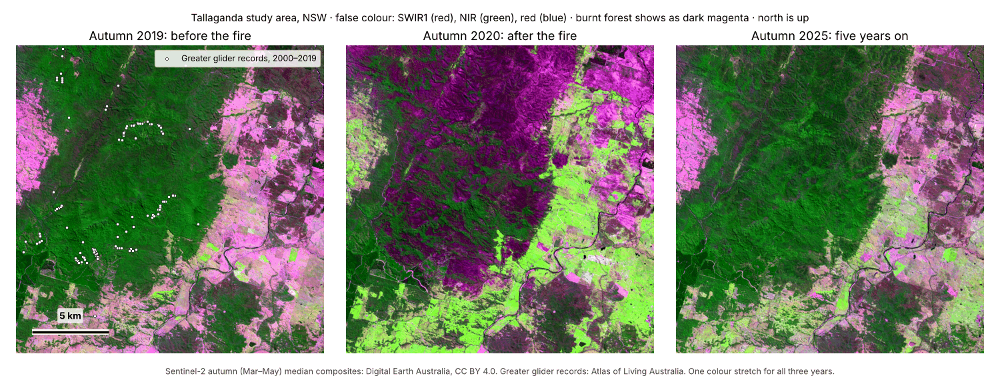

# Practical and Sovereign AI for Earth Observation
### A hands-on agentic coding workshop · AEO26

📍 **Monday 9 November 2026 · 9:00 am – 12:30 pm ·
[Advancing Earth Observation Forum 2026](https://www.earthobsforum.org/), Nipaluna/Hobart,
Lutruwita/Tasmania**

**What you'll do:** learn to work with an AI coding agent, Claude Code, by building something real
with it. You describe what you want in plain English, the agent writes and runs the code, and you
check the result. You don't need any coding experience. If you do code, there are harder tasks for
you. You finish by trying it on a question from your own work, with open data.

  
  &nbsp;
  

Or see <a href="#your-steps">every step, in order</a>.

**The example:** Sentinel-2 satellite images from before the 2019–20 Black Summer fires, just after
them, and five years later, for a forest area near Braidwood, NSW, together with fire-severity
mapping and greater glider records. All the data are open.

*One of the figures you'll build: the fire scar shows as dark magenta in 2020, and has mostly
greened up by 2025.*

## Your steps

Click each step in order. Every step ends with a **Next →** link, so you can keep going from there.

### Before the day

At home, about 20 minutes. You need a laptop with a web browser, a **personal** Claude account on
the **Pro** plan or higher (the free plan doesn't include Claude Code on the web; Pro is monthly, so
you can cancel it afterwards: [prices](https://claude.com/pricing)), and a free **personal** GitHub
account. Please use personal accounts, not work ones: work accounts are often set up to block the
tools we use, and nobody can change that on the day.

1. [Get a Claude Pro plan](SETUP.md#1-get-a-claude-pro-plan) · 5 min
2. [Get a GitHub account](SETUP.md#2-get-a-github-account) · 3 min
3. [Make your own private copy of this repo](SETUP.md#3-make-your-own-private-copy-of-this-repo) · 2 min
4. [Open Claude Code and connect GitHub](SETUP.md#4-open-claude-code-and-connect-github) · 3 min
5. [Let Claude see your copy, and nothing else](SETUP.md#5-let-claude-see-your-copy-and-nothing-else) · 2 min
6. [Set up your cloud environment](SETUP.md#6-set-up-your-cloud-environment) · 2 min
7. [Say hello](SETUP.md#7-say-hello) · 3 min
8. [Bring a question from your own work](SETUP.md#8-bring-a-question-from-your-own-work) · 2 min

Stuck? See [If something goes wrong](SETUP.md#if-something-goes-wrong).

### On the day

Monday 9 November, hands-on 09:35–10:30 and 11:25–11:55, then a closing talk and demo. Each step
opens in the [workbook](WORKBOOK.md).

| Time | Step |
|---|---|
| 09:35 | [Start: open your session](WORKBOOK.md#start-open-your-session) |
| 09:40 | [Early task: let Claude surprise you](WORKBOOK.md#early-task-let-claude-surprise-you). It keeps running while you do Part 1 |
| | **Part 1: Claude Code essentials** |
| 09:45 | [1. Meet the agent](WORKBOOK.md#step-1-meet-the-agent) |
| 09:50 | [2. Plan before you build](WORKBOOK.md#step-2-plan-before-you-build) |
| 09:55 | [3. Let it build, and make it check its own work](WORKBOOK.md#step-3-let-it-build-and-make-it-check-its-own-work) |
| 10:05 | [4. Memory and context](WORKBOOK.md#step-4-memory-and-context) |
| 10:10 | [5. Review, commit, merge](WORKBOOK.md#step-5-review-commit-merge) |
| | **Part 2: A practical build** |
| 10:15 | [6. Brief it, then walk away](WORKBOOK.md#step-6-brief-it-then-walk-away). Claude keeps building until 11:25: check on it from your phone, including your early task |
| 11:25 | [7. Trust, but verify](WORKBOOK.md#step-7-trust-but-verify) |
| 11:45 | [8. Make it yours](WORKBOOK.md#step-8-make-it-yours): brief Claude on a question from your own work |
| 11:55 | Talk and demo: sovereign AI, running open AI models on your own hardware. Your Step 8 brief keeps working |

Afterwards: [after the workshop](WORKBOOK.md#after-the-workshop).

## What's in this repo

| File or folder | What it is |
|---|---|
| [`WORKBOOK.md`](WORKBOOK.md) | The day's steps, with prompts to copy and things to check |
| [`SETUP.md`](SETUP.md) | Setup before the day, and what to do if something goes wrong |
| [`CLAUDE.md`](CLAUDE.md) | Standing instructions that Claude reads every time it starts work here |
| [`data/`](data/README.md) | The satellite images, fire severity, land cover and glider records. Read-only |
| [`outputs/`](outputs/) | Where Claude saves what it makes for you |
| [`CHECK_VALUES.md`](CHECK_VALUES.md) | The answers to check your results against (Part 2) |
| [`examples/`](examples/) | Example pictures of what your results should look like, a presenter's early-task test, and screenshots for the setup steps |
| [`presenters/`](presenters/README.md) | Notes for the presenters. You can ignore this folder |

## Is it safe?

- Claude works in a disposable computer in the cloud, not on your laptop.
- It works in **Auto** mode, so it doesn't stop to ask before each step. An automatic safety check
  looks at every action, and everything happens in that cloud computer.
- For the workshop you give that computer **Full** network access (setup step 6), so it can
  download satellite data from any website.
- Claude can see only the one repo you allow (your private copy). Your GitHub password never goes
  into the cloud computer.
- Don't paste passwords, keys or private data into Claude.

Please use the browser or the phone app, **not the Claude Desktop app**, for this workshop. The
Desktop app can act on the files on your own laptop, which is exactly what we want to avoid while
you're learning.

## No paid plan?

Pair up with a neighbour who has one: one of you types, the other checks, then you swap. The
presenters also have a few guest passes (a free 7-day Pro trial).

## Want a head start? (optional, free)

- [Claude Code 101](https://academy.claude.com/courses/claude-code-101) (1.5 hours). Part 1 is built
  from its key lessons.
- [Claude Code in Action](https://academy.claude.com/courses/claude-code-in-action) (1 hour). Part 2
  uses its lesson on checking work you didn't watch.
- New to AI tools? Try [Claude 101](https://academy.claude.com/courses/claude-101) or
  [AI Fluency: Framework & Foundations](https://academy.claude.com/courses/ai-fluency-framework-foundations).

---

**Presenters:** Adam Roff (Senior Research Scientist, Vegetation & Biodiversity Mapping, DCCEEW NSW)
and Fang Yuan (Earth Observation Australia), with guest speakers to be announced. The program is a
draft until the official [AEO26 program](https://www.earthobsforum.org/) is published. Tickets:
[ti.to/earth-observation-australia/aeo-forum-2026](https://ti.to/earth-observation-australia/aeo-forum-2026)
(workshop tickets are sold separately). Questions:
[open an issue](https://github.com/RSGISagent/AEO26_AgenticAI_Workshop/issues).

*We acknowledge the First Nations peoples of Australia as the original observers of our Earth, and
the Muwinina people, traditional owners of the land on which AEO26 gathers in Nipaluna/Hobart.*
