# Setup before the workshop

It takes **about 20 minutes**. Please do it at home before Monday 9 November, so the morning is about
learning, not logging in. On the day we start with a quick check, and helpers will sort out anything
that's stuck.

Use the same web browser for every step, and use **personal** accounts, not work ones.

**Jump to a step:** [1](#1-get-a-claude-pro-plan) · [2](#2-get-a-github-account) · [3](#3-make-your-own-private-copy-of-this-repo) · [4](#4-open-claude-code-and-connect-github) · [5](#5-let-claude-see-your-copy-and-nothing-else) · [6](#6-set-up-your-cloud-environment) · [7](#7-say-hello) · [8](#8-bring-a-question-from-your-own-work) · [If something goes wrong](#if-something-goes-wrong)

## 1. Get a Claude Pro plan

*About 5 minutes.*

1. Go to [claude.ai](https://claude.ai) and click **Continue with Google**. We recommend a personal
   Google account, or a spare one you make just for this workshop. Don't use a work account.
2. Upgrade to **Pro** (or a higher individual plan, such as Max). Pro is a monthly subscription, so
   you can cancel it after the workshop. Prices: [claude.com/pricing](https://claude.com/pricing).

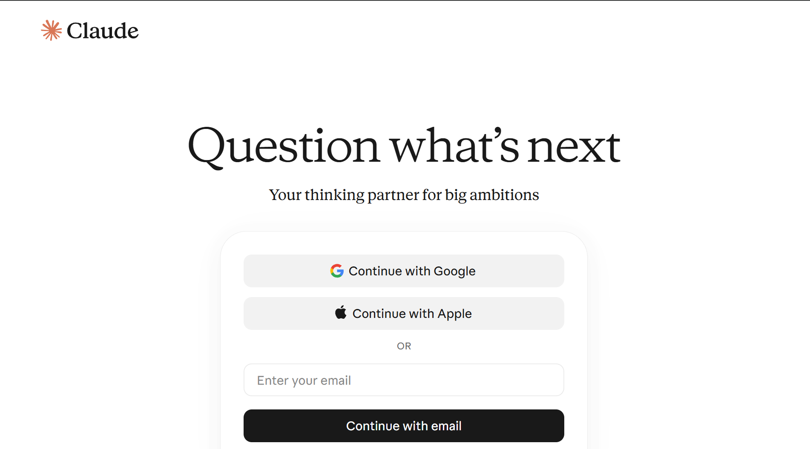

*The sign-in page at claude.ai. **Continue with Google** is the first button.*

Have a guest pass from the presenters instead? Open its link and follow the prompts. It gives you a
7-day Pro trial.

**Next →** [2. Get a GitHub account](#2-get-a-github-account) · [All steps](README.md#your-steps)

## 2. Get a GitHub account

*About 3 minutes.*

1. Go to [github.com](https://github.com) and sign up with your personal email. The free plan is
   fine.
2. Your username is your **handle**. Note it down.

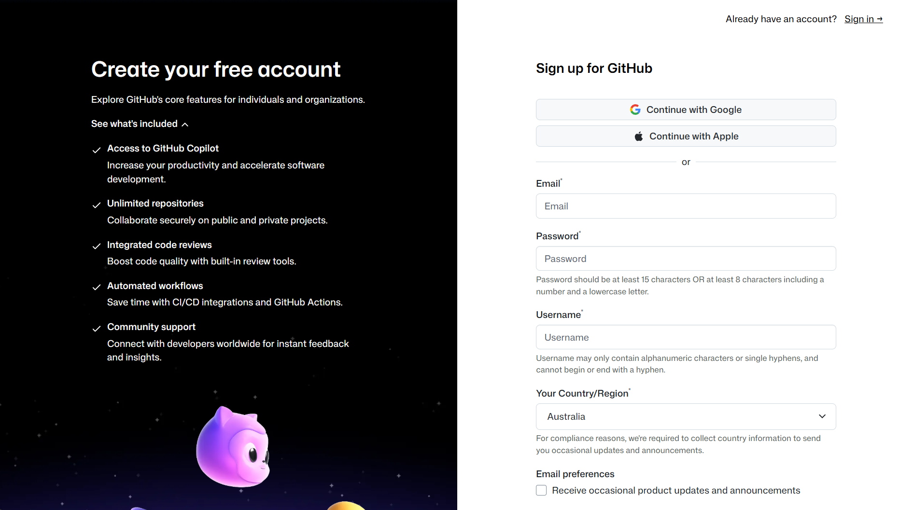

*The GitHub sign-up page. The username you choose here is your handle.*

**Next →** [3. Make your own private copy of this repo](#3-make-your-own-private-copy-of-this-repo) · [All steps](README.md#your-steps)

## 3. Make your own private copy of this repo

*About 2 minutes.*

1. While signed in to GitHub, click this link:
   **[Make my private copy](https://github.com/new?template_owner=RSGISagent&template_name=AEO26_AgenticAI_Workshop&owner=@me&visibility=private&name=aeo26-workshop)**
2. Check that **Start with a template** shows `RSGISagent/AEO26_AgenticAI_Workshop`. If it doesn't,
   and you see **Add README**, **Add .gitignore** and **Add license** options instead, it would make
   an empty repo: use the steps under *The link doesn't work?* below.
3. Check that **Owner** is you, that the name is `aeo26-workshop`, and that **Private** is selected.

   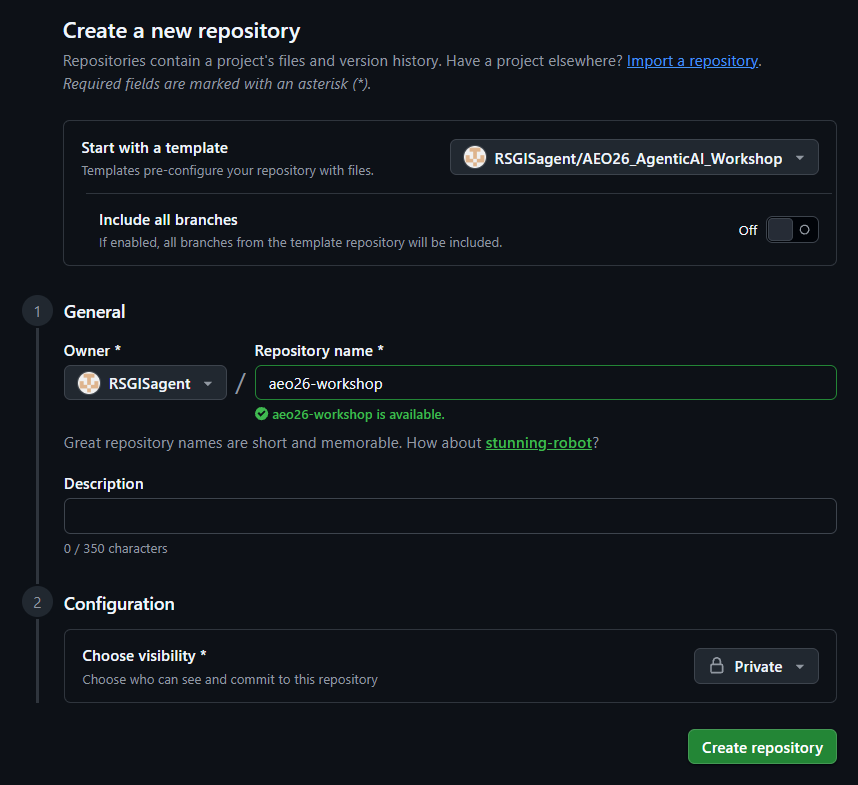

4. Click **Create repository**.

You now have `github.com/<your-handle>/aeo26-workshop`, marked **Private**. Everything you do in the
workshop is saved there, and only you can see it.

*Why a copy and not a "fork"? A fork of a public repo is always public. A copy made from a template
is yours, and it can be private.*

*The link doesn't work?* Open
[github.com/RSGISagent/AEO26_AgenticAI_Workshop](https://github.com/RSGISagent/AEO26_AgenticAI_Workshop),
click **Use this template**, then **Create a new repository**, and fill in the same details.

**Next →** [4. Open Claude Code and connect GitHub](#4-open-claude-code-and-connect-github) · [All steps](README.md#your-steps)

## 4. Open Claude Code and connect GitHub

*About 3 minutes.*

1. Go to [claude.ai/code](https://claude.ai/code).
2. On the **Code with Claude anywhere** page, click **Continue with GitHub** and approve it. Check
   that it shows your personal GitHub account.
3. Skipped that page? Click **Connect GitHub** on the new-session screen instead.

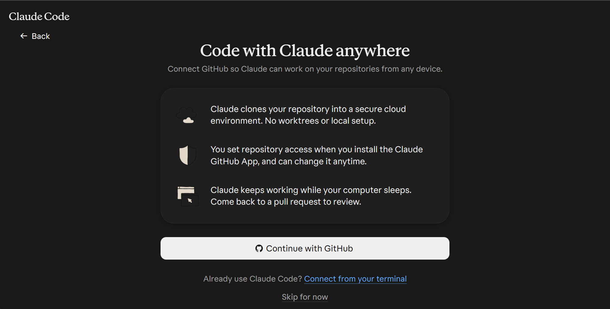

*The first time you open Claude Code, it asks you to connect GitHub.*

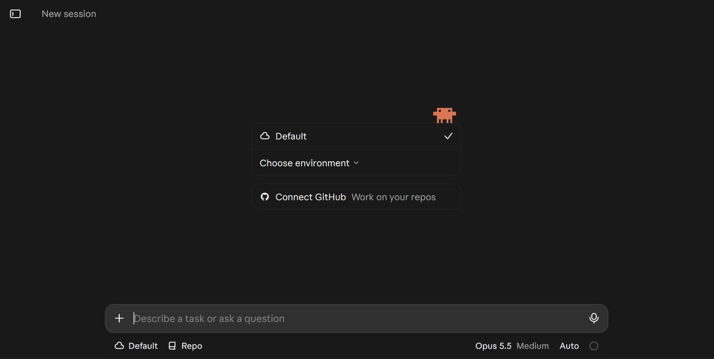

*The new-session screen before GitHub is connected. The first button under the message box is the
environment, here **Default**: you'll change it in step 6. The model and mode may differ on your
account.*

**Next →** [5. Let Claude see your copy, and nothing else](#5-let-claude-see-your-copy-and-nothing-else) · [All steps](README.md#your-steps)

## 5. Let Claude see your copy, and nothing else

*About 2 minutes.*

1. When asked, install the **Claude GitHub App**. You can also start the install from
   [github.com/apps/claude/installations/new](https://github.com/apps/claude/installations/new).
2. Choose your personal account.
3. Choose **Only select repositories**, pick `aeo26-workshop`, and install.

   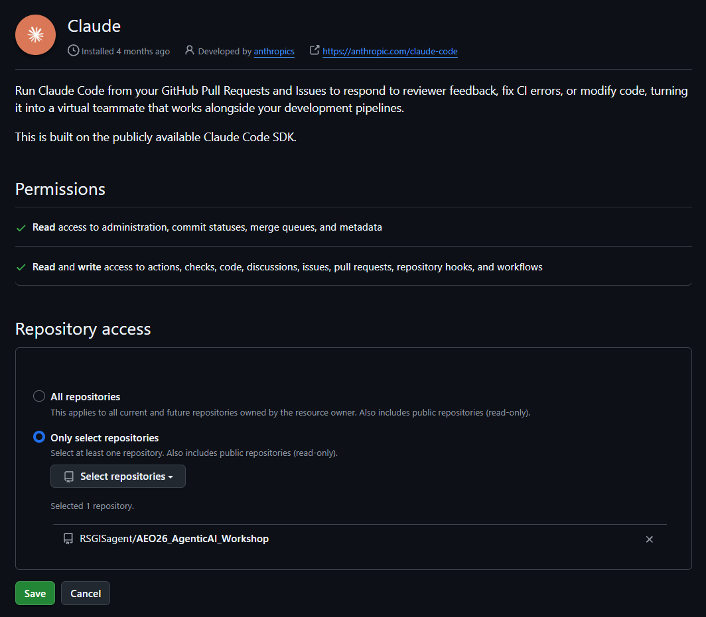

   *Only select repositories, with one repository picked. Yours will say `<your-handle>/aeo26-workshop`.
   This account already had the app, so its button says **Save**.*

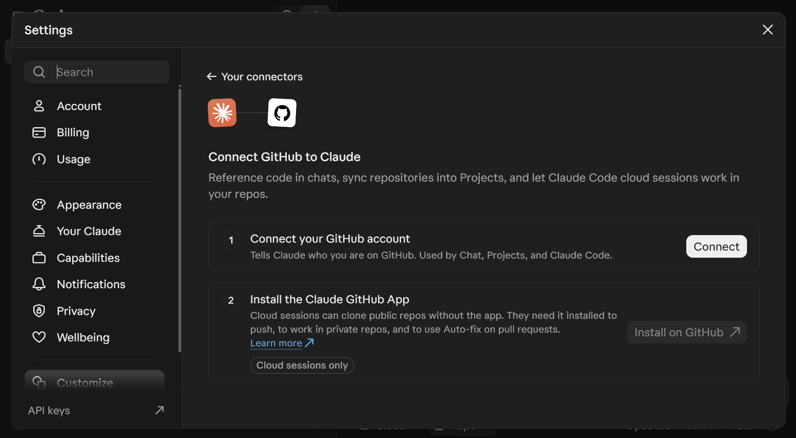

*The same two steps in Claude's settings, on the GitHub page under **Your connectors**: **Connect**
links your GitHub account (step 4), and **Install on GitHub** installs the app (this step). Without
the app, Claude can't work in your private copy.*

*Already installed the Claude app before, for example on another repo?* On GitHub, go to
**Settings → Applications → Installed GitHub Apps → Claude → Configure**. Add `aeo26-workshop` under
**Only select repositories**, and click **Save**.

**Next →** [6. Set up your cloud environment](#6-set-up-your-cloud-environment) · [All steps](README.md#your-steps)

## 6. Set up your cloud environment

*About 2 minutes.*

Claude works in a cloud computer that, by default, can reach only a short list of sites, such as
package sites and GitHub. The workshop needs **Full** network access, so Claude can download
satellite data.

1. At [claude.ai/code](https://claude.ai/code), click the environment button under the message box.
   It may say **Default** or **Auto**.

   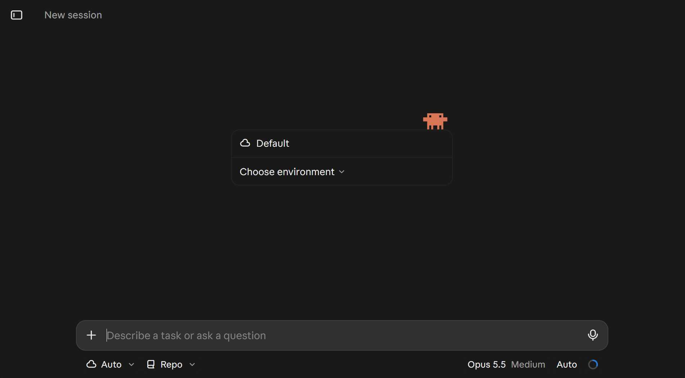

2. At the bottom of the list, choose **+ New environment**.

   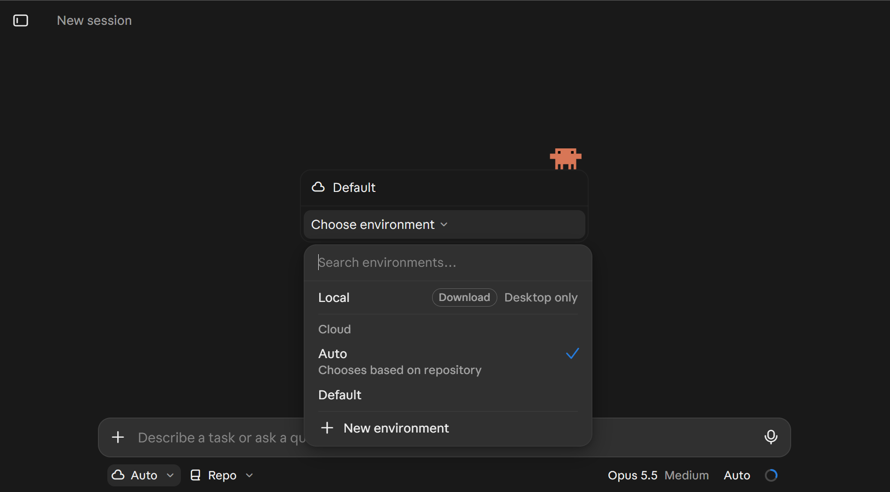

3. Keep the **Cloud** tab, and type the name `AEO`.

   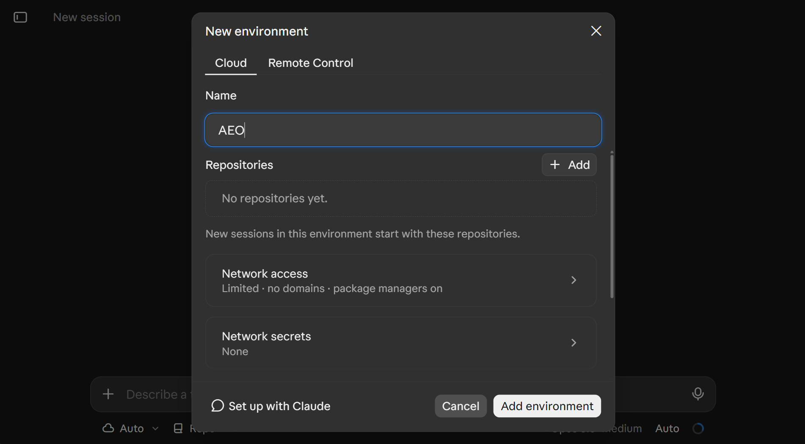

4. Click **Network access**. It starts as **Limited**: open the list and choose **Full** ("Sessions
   can reach any domain"). Leave everything else as it is.

   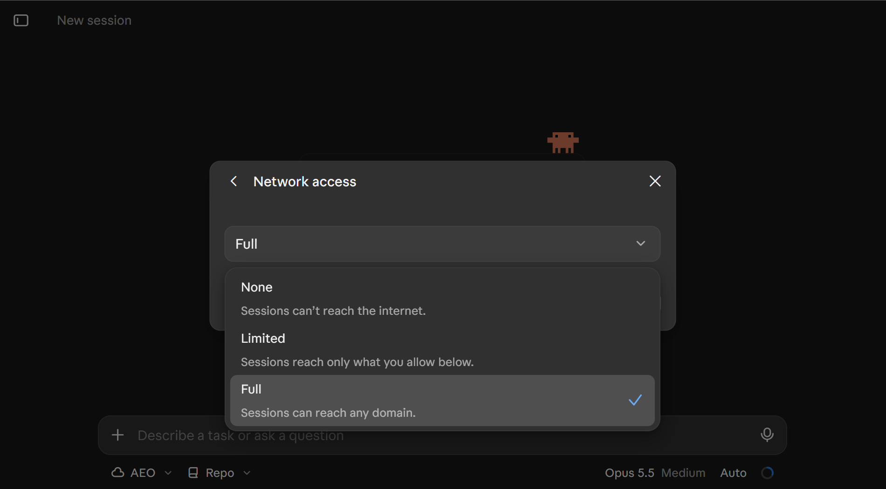

5. Click **Add environment**. The button under the message box now says **AEO**.

   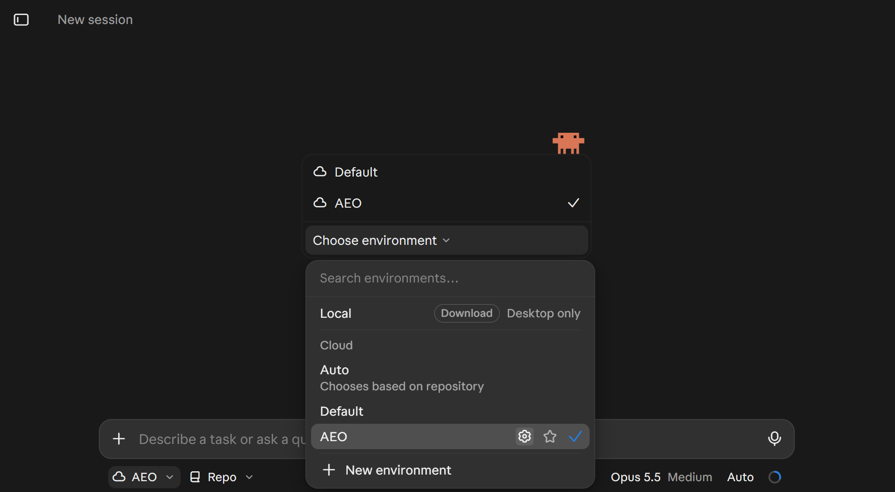

**Check it:** click the gear next to **AEO** in that list. **Network access** must say **Full**. If it
says **Limited**, as in this picture, click it, choose **Full**, then click **Save changes**.

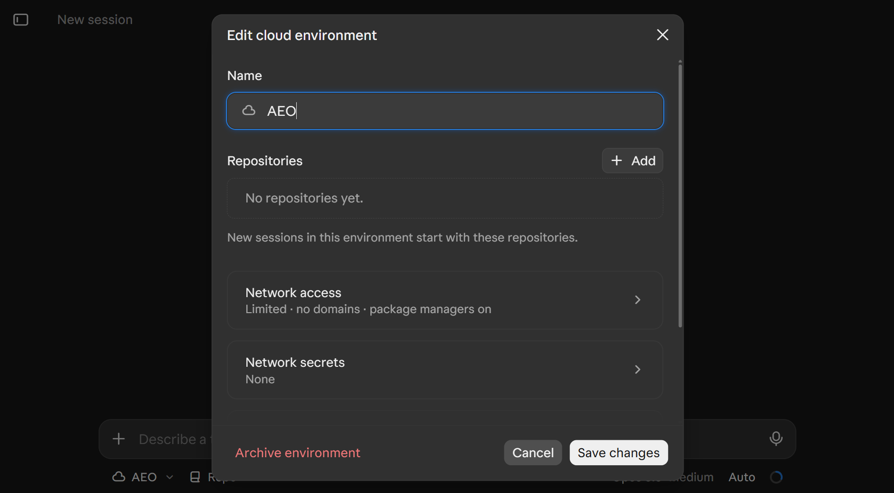

*Full network access lets Claude reach any website. That's what it needs to fetch data, and it's
one more reason never to paste passwords, keys or private data into Claude.*

**Next →** [7. Say hello](#7-say-hello) · [All steps](README.md#your-steps)

## 7. Say hello

*About 3 minutes.*

1. At [claude.ai/code](https://claude.ai/code), choose `aeo26-workshop` in the repository list.
2. Check that the environment button under the message box says **AEO**. If it doesn't, click it
   and choose **AEO**.
3. In the mode menu at the right-hand end of the row under the message box, choose **Auto**. You'll
   use it all morning. Can't see **Auto**? Tell a helper when you arrive.
4. Send: `Hello! In one sentence, what is this repo for?`

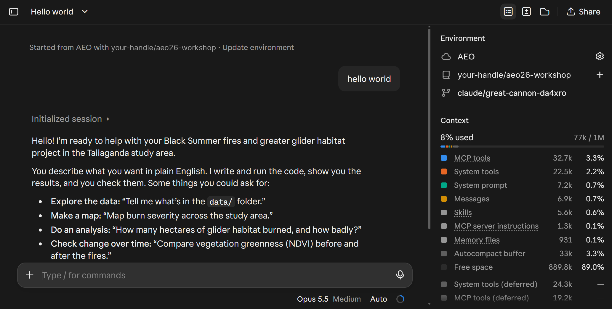

*A working session. The panel on the right shows the **AEO** environment and your copy, and Claude
has read the repo. (This test sent `hello world`: any short message works.)*

If Claude answers, it works. One last thing, and it doesn't need a computer: step 8.

**Next →** [8. Bring a question from your own work](#8-bring-a-question-from-your-own-work) · [All steps](README.md#your-steps)

## 8. Bring a question from your own work

*About 2 minutes.*

At the end of the workshop, you'll ask Claude about a question from your own work, using open
satellite data. Have one ready:

- **A question** that open data could help answer. For example: "How much has the canopy recovered
  at my field sites since the 2019–20 fires?", "Where has this wetland held water since 2017?" or
  "Has NDVI in this woodland changed since 2016?"
- **A place:** a place name, or a rough box in longitude and latitude.
- **Dates:** the dates or seasons to compare.
- **Something you already know** about that place, to check Claude's answer against.

Keep it small: one place, one question, one figure. Use open data only: the workbook explains why.

**All done!** See you on Monday. On the day, start with the
[workbook](WORKBOOK.md#start-open-your-session). · [All steps](README.md#your-steps)

---

## If something goes wrong

- **"Claude Code isn't available on your account."** Check that you're on Pro, and that you're
  signed in to the personal account you upgraded. After upgrading, sign out and back in.
- **My copy isn't in the list at claude.ai/code.** The Claude GitHub App must be allowed on
  `aeo26-workshop` (step 5). Check that you connected the same GitHub account that owns the copy,
  then reload the page.
- **My copy came out public, or went to an organisation.** If it's public, go to **Settings →
  General → Danger Zone → Change visibility** and choose **Private**. If it went to an organisation,
  delete it and repeat step 3 with yourself as the owner.
- **The first session is slow.** The first start copies your repo into a fresh cloud computer. Give
  it a couple of minutes.
- **Claude says a website is blocked, or it can't download data.** Check that the session uses your
  **AEO** environment with **Full** network access (step 6). In a running session, click the arrow
  next to the session title, then **Edit cloud environment**.
- **Claude keeps asking for permission.** Check the mode menu at the right-hand end of the row under
  the message box: it should say **Auto**. Other modes, such as **Accept edits**, stop to ask before
  every command.
- **Anything else.** Bring it on the day: helpers fix setups when the hands-on starts. You can also
  [open an issue](https://github.com/RSGISagent/AEO26_AgenticAI_Workshop/issues).

Official help: [Claude Code in the cloud](https://code.claude.com/docs/en/claude-code-on-the-web) ·
[Creating a repository from a template](https://docs.github.com/en/repositories/creating-and-managing-repositories/creating-a-repository-from-a-template).
