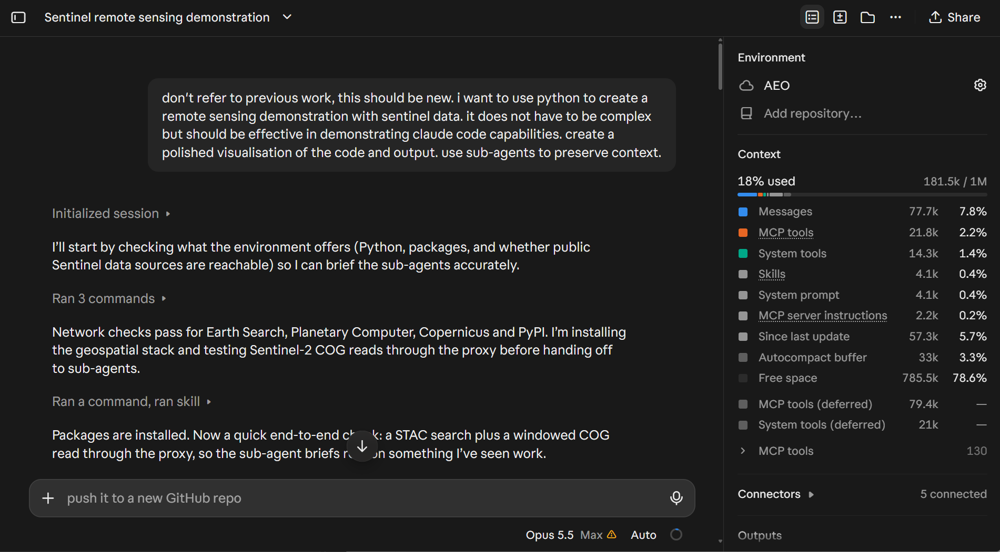
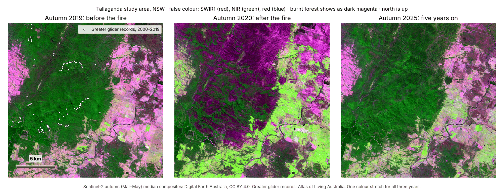
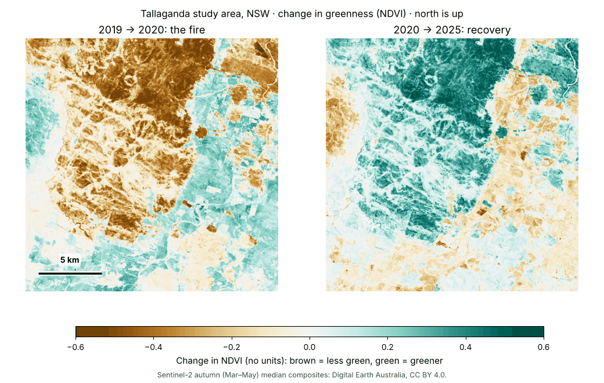
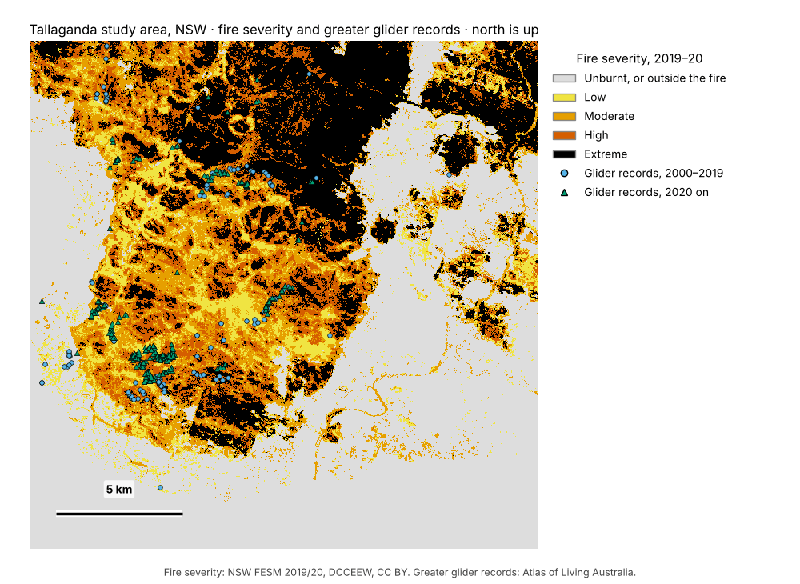

# AEO26 workbook: build with Claude Code

*Practical and Sovereign AI for Earth Observation* · AEO26 Workshop 1 · Nipaluna/Hobart · Monday
9 November 2026

> **Live copy:** if the presenters announce a fix on the day, use the copy in the workshop repo:
> [WORKBOOK.md](https://github.com/RSGISagent/AEO26_AgenticAI_Workshop/blob/main/WORKBOOK.md).

**Today you won't write code.** You tell Claude Code what you want, it writes and runs the code,
and you check the result. Everything happens in **this private repo**, so it all stays yours.

- **Part 1 (09:45–10:15):** the essentials of Claude Code, from the free
  [Claude Academy](https://academy.claude.com) intro courses. One idea at a time, each tried
  straight away on real data.
- **Part 2 (10:15–11:55):** a practical build. You brief Claude to build a small fire-and-glider
  habitat explorer, leave it working over morning tea, then check its work like a supervisor.
  Last, you brief it on a question from your own work.

**Hands-on times:** 09:35–10:30 and 11:25–11:55. Your last brief keeps working through the closing
talk and demo (11:55–12:15) on running open AI models on your own hardware.

**Jump to a step:** [Start](#start-open-your-session) · [Early task](#early-task-let-claude-surprise-you) · [1](#step-1-meet-the-agent) · [2](#step-2-plan-before-you-build) · [3](#step-3-let-it-build-and-make-it-check-its-own-work) · [4](#step-4-memory-and-context) · [5](#step-5-review-commit-merge) · [6](#step-6-brief-it-then-walk-away) · [7](#step-7-trust-but-verify) · [8](#step-8-make-it-yours) · [After the workshop](#after-the-workshop)

## How this workbook works

- **Grey boxes are prompts.** Copy one, paste it into the Claude Code message box, and send it.
- **Work in Auto mode.** The mode menu is at the right-hand end of the row under the message box
  (not the environment button on the left, which should say **AEO**). Today you use two modes:

  | Mode | What Claude can do without asking you |
  |---|---|
  | **Auto** | Everything, with an automatic safety check on each action. Your default all morning |
  | **Plan** | Read and suggest. It changes nothing. Use it when a step asks for a plan |

  Claude works in a disposable cloud computer, separate from your laptop, that holds only your copy
  of this repo. That's why it can work fast without stopping to ask. You'll also see **Accept edits**
  in the menu: we don't use it today, because it stops to ask before every command.

- **"You should see"** tells you what success looks like. The pictures are example results: yours
  will differ a little, and that's fine. In the room, put up a sticky note marked **✓** when you're
  there, or **?** if you're stuck.
- **"If you code"** lines are optional extras.

**It's safe to experiment**

- Nothing you do today touches your laptop. Claude works in a cloud computer that holds only your
  private copy of this repo.
- Claude saves its work in Git, your repo's history, so a change can be undone.
- Press the stop button at any time. If a session gets muddled, start a new one: your repo keeps
  everything that was saved.
- Mistakes are part of the plan. You're the remote sensing expert; Claude is a fast junior analyst
  who needs supervising. Catching its errors is the skill you're here to practise.

**Useful things to say to Claude**

| Say | When |
|---|---|
| "Plan only." | Before anything big: see the plan before anything changes |
| "What did you assume?" | After any result |
| "Show me the command you ran and what it printed." | When you want evidence, not just "done" |
| "Explain that in plain English." | Whenever something is unclear |
| "Check that against …" | To compare with a number or a source you trust |
| "Undo that." | When a change went the wrong way |

---

## Start: open your session

*09:35 · 5 minutes*

**What you'll do:** open your private repo in Claude Code and check that it answers.

**Do this**

1. Open [claude.ai/code](https://claude.ai/code).
2. In the repo list, pick **this repo** (`<your-handle>/aeo26-workshop`, marked private).
3. Check that the environment button under the message box says **AEO**, the environment you made
   in [setup step 6](SETUP.md#6-set-up-your-cloud-environment).
4. Set the mode to **Auto**.
5. Send:

```text
Hello! In one sentence, what is this repo for? Then install the Python packages in requirements.txt, so they're ready for later.
```

**You should see:** a reply within a minute or two. The first start takes longer while the cloud
computer copies your repo. The packages can take a few more minutes: start the early task while it
works.

**Stuck?** See [If something goes wrong](SETUP.md#if-something-goes-wrong), or put up a sticky note
marked **?**.

**Next →** [Early task: let Claude surprise you](#early-task-let-claude-surprise-you) · [All steps](README.md#your-steps)

## Early task: let Claude surprise you

*09:40 · 3 minutes to start, then it runs by itself*

**What you'll do:** give Claude a short, open request in a second session, and leave it working
while you do Part 1.

**Why it matters:** it shows what one plain sentence can do. Later, in Step 8, you come back to it
with a more critical eye.

**Do this**

1. Go back to [claude.ai/code](https://claude.ai/code) and start a **new session** on this repo, in
   your **AEO** environment. Your first session stays as it is.
2. Check that the mode is **Auto**.
3. Paste this exactly as it is, and send it:

```text
i want to use python to create a remote sensing demonstration with sentinel data from australia. it does not have to be complex but should be effective in demonstrating claude code capabilities. use sub-agents to conserve context window
```

4. Go back to your first session and start Step 1. This one keeps working by itself in the cloud.

*Sub-agents* are helpers that Claude starts for parts of the job. Each one has its own working
memory and reports back a short summary, so the main session's memory (its *context window*) stays
uncluttered. Look out for them in the session as separate blocks of work.

**Good to know**

- **If it asks you a question,** answer briefly, or say "you choose".
- **It may download more satellite data.** Your **AEO** environment allows that. It may also use the
  data in this repo. Either is fine.
- **If it opens a pull request, don't merge it yet.** Its work stays on its own branch, so it won't
  get in the way of Part 1.

**You should see:** two sessions in your session list, with the new one busy. Everyone's result
will be different, and that's the point.



*A presenter's test of a similar request, a few minutes in, in a session with no repo and every
website allowed. Before handing work to sub-agents, Claude checks which data sites it can reach,
installs packages and tests a small download. The **Context** panel on the right shows how much of
its working memory is in use. Your screen will differ: the model, the numbers and the environment
name depend on your account.*

**What a longer request made:** a later test, with a longer request than the one above, made a web
page about the 2019–20 Black Summer fires in the Greater Blue Mountains, NSW. It maps burn severity
from Sentinel-2 images and compares it with the NSW Government's fire severity map (FESM, *Fire
Extent and Severity Mapping*), with 95% intervals (the range the true value most likely lies in).
It then follows the forest's recovery to 2026, and shows the code and output for each step.


*A summary of the page's results: the burnt landscape on 30 Jan 2020 (a), burn severity from the
demo (b) and from FESM (c), where they differ (d), and how greenness (NDVI, a satellite index of green leaves) recovered in each FESM
severity class up to 2026 (e). The page itself adds a before-and-after slider and the code for each
step.*

**Try it yourself:** [download the page](https://github.com/RSGISagent/AEO26_AgenticAI_Workshop/raw/main/examples/early_task/blue_mountains_demo.zip)
(a 6.7 MB zip file). Open the zip, then double-click `blue_mountains_demo.html`. It opens in your
browser and works offline.

**Come back to it** at morning tea (have a look from your phone). In
[Step 8](#step-8-make-it-yours) you compare it with your Step 6 build, and you can check it
properly after the workshop.

**Learn more:** Claude Code 101,
["Your first prompt"](https://academy.claude.com/courses/claude-code-101/your-first-prompt).

**Next →** [Step 1: Meet the agent](#step-1-meet-the-agent) · [All steps](README.md#your-steps)

---

## Part 1: Claude Code essentials

*09:45–10:15 · five short steps, all in your first session*

### Step 1: Meet the agent

*09:45 · 5 minutes · mode: **Auto***

**What you'll do:** ask Claude to explain the repo, and watch how it works it out.

**Why it matters:** Claude Code is an agent, not a chatbot. It works in a loop: it **gathers
information** (reads files, searches), **acts** (edits files, runs commands) and **checks** (runs
things and looks at the result), until the job is done. Each grey block in the conversation is one
of those actions. It works in a disposable cloud computer that holds a copy of this repo, and your
GitHub password never goes into it.

**Do this**

```text
What's in this repository? Explain each file in data/ in plain English: what it shows, its units,
its dates and its map projection. Then suggest three small things we could build with it in under
an hour. Don't change anything.
```

**You should see**

- Grey blocks you can click open to see exactly which file Claude read, or which command it ran.
- An answer that covers the satellite images' units (reflectance × 10,000, with −999 for "no
  data"), the map projection (EPSG:3577, 10 m pixels), the fire-severity classes, and that the
  glider locations are latitude and longitude.

**If you code:** ask *"Which files did you read, and why those?"* Notice that it read `CLAUDE.md`
without being told.

**Learn more:** Claude Code 101,
["What is Claude Code?"](https://academy.claude.com/courses/claude-code-101/what-is-claude-code) and
["How Claude Code works"](https://academy.claude.com/courses/claude-code-101/how-claude-code-works).

**Next →** [Step 2: Plan before you build](#step-2-plan-before-you-build) · [All steps](README.md#your-steps)

### Step 2: Plan before you build

*09:50 · 5 minutes · mode: **Plan***

**What you'll do:** ask for a plan for your first figure, then change the plan before anything is
built.

**Why it matters:** checking a plan takes a minute; fixing a wrong build takes ten. Say what "done"
looks like, and ask how Claude will check it.

**Do this:** switch the mode to **Plan**, then send:

```text
Plan a Python script, before_after.py, that shows the study area in autumn 2019 (before the fire),
2020 (after the fire) and 2025 (five years on) as three false-colour images side by side
(red = SWIR1, green = NIR, blue = red), with the same colour stretch on all three, saved to
outputs/before_after.png. Tell me how you will check that the figure is right. Plan only.
```

Read the plan. Does it name the three image files, divide by 10,000, leave out the −999 "no data"
pixels, use **one** colour stretch for all three years, and say how it will check the figure? Then
change one thing:

```text
One change: also show the greater glider records from 2000-2019 as small white dots on the 2019
panel. The coordinates are latitude/longitude, so reproject them to the rasters' projection.
```

**You should see:** a revised plan that includes the glider dots and the change of coordinates.

**Learn more:** Claude Code 101,
["Your first prompt"](https://academy.claude.com/courses/claude-code-101/your-first-prompt) and
["The explore → plan → code → commit workflow"](https://academy.claude.com/courses/claude-code-101/the-explore-plan-code-commit-workflow).

**Next →** [Step 3: Let it build, and make it check its own work](#step-3-let-it-build-and-make-it-check-its-own-work) · [All steps](README.md#your-steps)

### Step 3: Let it build, and make it check its own work

*09:55 · 10 minutes · mode: **Auto***

**What you'll do:** let Claude build the figure, then make it check its own result.

**Why it matters:** this is the most useful habit of all. Ask for evidence (the command and its
output, the figure, a test) rather than taking "done" on trust. If it heads the wrong way, press
stop and say what you want instead.

**Do this**

1. Switch the mode back to **Auto**, then send:

```text
The plan is good. Build it.
```

2. Watch it work. It writes the script and runs it without stopping to ask. Click a grey block to
   see the exact command it ran and what it printed.
3. Before you look at the figure, decide what you expect: where should the fire scar be in 2020,
   and how should it look in this false colour? Then ask Claude to check its work:

```text
Open outputs/before_after.png and check it critically: are the three panels comparable, labelled
with the year, and is the burnt area obvious in 2020? Then print the minimum and maximum reflectance
you plotted, so I can check the units.
```

4. Ask for **one** change you'd want as a reviewer, in your own words, such as bigger titles or a
   scale bar.

**You should see** something like this. The 2020 panel shows a large burnt patch in dark magenta,
which has mostly greened up again by 2025, and the reflectance values are between 0 and 1.



*An example result. It already has the caption you'll add in Step 4. Want to see yours now? Ask
"Send me outputs/before_after.png". Otherwise you'll see it on GitHub in Step 5.*

**Learn more:** Claude Code 101,
["The explore → plan → code → commit workflow"](https://academy.claude.com/courses/claude-code-101/the-explore-plan-code-commit-workflow),
and the Claude Code [best practices](https://code.claude.com/docs/en/best-practices).

**Next →** [Step 4: Memory and context](#step-4-memory-and-context) · [All steps](README.md#your-steps)

### Step 4: Memory and context

*10:05 · 5 minutes · mode: **Auto***

**What you'll do:** look at Claude's working memory, then add a standing rule that it follows from
now on.

**Why it matters:** `CLAUDE.md` holds Claude's standing instructions. Claude reads it at the start
of every session, so you can teach it your lab's conventions once instead of in every prompt. The
*context window* is Claude's working memory: long sessions get summarised automatically, and a new
task deserves a fresh session.

**Do this**

1. Type this command and send it:

```text
/context
```

2. Then send this. If you like, change the words in quotes to a rule of your own: something you
   always want in your figures, such as the projection, or your lab's colours.

```text
Add this rule to CLAUDE.md under "Rules": "Every figure gets a one-line caption underneath that
names the data sources and dates." Then re-run before_after.py so the figure follows the new rule.
```

**You should see**

- `/context` shows how much of the working memory is in use, and what it's used for. The
  **Context** panel on the right shows the same.
- The figure now follows your rule. With the rule above, it has a caption like the example in
  Step 3.
- Your new rule in `CLAUDE.md`, in the **Changes** view.

**If you code:** `/compact keep the figure decisions` summarises the conversation, keeping what you
name. `/clear` starts over with an empty memory.

**Learn more:** Claude Code 101,
["The CLAUDE.md file"](https://academy.claude.com/courses/claude-code-101/the-claude-md-file) and
["Context management"](https://academy.claude.com/courses/claude-code-101/context-management);
Claude Code in Action,
["A CLAUDE.md that follows"](https://academy.claude.com/courses/claude-code-in-action/a-claude-md-that-follows).

**Next →** [Step 5: Review, commit, merge](#step-5-review-commit-merge) · [All steps](README.md#your-steps)

### Step 5: Review, commit, merge

*10:10 · 5 minutes · mode: **Auto***

**What you'll do:** read what Claude changed, then add it to your project.

**Why it matters:** you are the reviewer. Claude works on its own *branch*, a separate line of
changes. A *pull request* (PR) asks to add that branch to `main`, your project's main line.
Always read the changes (the *diff*) before you merge them.

**Do this**

1. Send:

```text
Commit the script, the figure and the CLAUDE.md change with a clear message, and push.
```

2. Open the **Changes** card beside the chat, then click a file to see what changed.
3. Click one line and leave a comment, for example *"Why this stretch?"*. Send it, and read the
   answer.
4. Click **Create PR**. On GitHub, open **Files changed**: your figure shows as a picture.
5. Click **Merge pull request**, then **Confirm merge**.

**You should see:** the PR merged, and `outputs/before_after.png` on your `main` branch.

**Learn more:** Claude Code 101,
["Code review"](https://academy.claude.com/courses/claude-code-101/code-review).

**Next →** [Step 6: Brief it, then walk away](#step-6-brief-it-then-walk-away) · [All steps](README.md#your-steps)

---

## Part 2: A practical build

*10:15–11:55 · a fire-and-glider habitat explorer*

### Step 6: Brief it, then walk away

*10:15 · 15 minutes, then morning tea · mode: **Plan**, then **Auto***

**What you'll do:** give Claude one complete brief, check its plan, then let it build while you're
at morning tea.

**Why it matters:** a good brief is a mission, not a chat. It says what to make, how to check it,
and what to do when unsure.

**Do this**

1. Is your early-task session still working? Press its stop button first: two busy sessions use
   your plan's allowance faster, and this build matters more. Stopping keeps everything it has
   pushed, and you can tell it to carry on later.
2. Start a **new session** on this repo. It starts from your updated `main` with an empty memory.
   Set the mode to **Plan**.
3. Paste the brief:

```text
Build a small, reusable tool in this repo: explorer.py. Running `python explorer.py` should write
these to outputs/:

1. ndvi_change.png: NDVI change from autumn 2019 to 2020 (the fire) and from 2020 to 2025
   (recovery), as two panels with one shared, colour-blind-safe diverging colour scale centred on
   zero and a labelled colour bar.
2. severity_summary.csv: one row per fire-severity class (unburnt/outside, low, moderate, high,
   extreme) with the area in hectares, the mean NDVI in 2019, 2020 and 2025, and the number of
   greater glider records from 2000 to 2019 inside that class.
3. REPORT.md: a one-page, plain-English summary with the table, the figures, how each number was
   calculated, and any assumptions you made.
4. glider_map.html: an interactive map of fire severity and the glider records. Skip this if it
   takes more than 10 minutes, and say so in REPORT.md.

Also:
- Write tests in tests/test_explorer.py (at least NDVI of known values, and the hectares of a tiny
  made-up raster) and run them.
- Add a "How to run" section to README.md.
- Commit and push after each output works. When everything works, open a pull request into main
  that summarises the results.

First show me your plan. Once I approve it, work without asking me questions: record assumptions in
REPORT.md, and open every figure to check it before moving on.
```

4. Check the plan. Does it leave out the "no data" values (−999 in the images, 255 in the severity
   map), convert the glider coordinates, work out areas from pixel counts (one pixel = 0.01 ha), use
   one shared colour scale, and include tests? If not, tell it.
5. Switch the mode to **Auto** and reply `Approved. Go ahead.`
6. Once it's working (installing packages or writing code), go to morning tea. It keeps working in
   the cloud even if you close your laptop.

**You should see:** a to-do list, then its first commits. At morning tea, open the **Code** tab in
the Claude mobile app to watch it, or to answer it if it asks something.

**What it should make:** something like these two pictures, plus the table in Step 7.



*Example `ndvi_change.png`. The fire shows as brown (less green), then the recovery as green.*



*A still picture of what `glider_map.html` shows. The real file is a map you can zoom and click.*

**Learn more:** Claude Code in Action,
["Steering long sessions"](https://academy.claude.com/courses/claude-code-in-action/steering-long-sessions)
and ["Permission modes"](https://academy.claude.com/courses/claude-code-in-action/permission-modes).

**Next →** [Step 7: Trust, but verify](#step-7-trust-but-verify) · [All steps](README.md#your-steps)

### Step 7: Trust, but verify

*11:25 · 20 minutes · mode: **Plan**, then **Auto***

**What you'll do:** check the work you didn't watch, then merge it.

**Why it matters:** an agent can be confidently wrong. Check in this order: read what changed, check
the numbers, then get a fresh pair of eyes.

**Do this**

1. **Read what changed.** Open the pull request on GitHub, then **Files changed**. Read `REPORT.md`
   and look at the figures. Do they look like the examples in [Step 6](#step-6-brief-it-then-walk-away)?
   GitHub shows `glider_map.html` as code, not as a map. To see the map, ask your Step 6 session
   for *"the GitHub link to outputs/glider_map.html on your branch"*. Open the link, click the
   download arrow next to **Raw**, then open the downloaded file in your browser.
2. **Check the numbers.** First, guess: from your Step 3 figure, roughly what share of the
   20 × 20 km square burnt? Then compare your `severity_summary.csv` with these answers:

   | Fire severity | Area (ha) | Mean NDVI 2019 | 2020 | 2025 | Glider records 2000–2019 |
   |---|---:|---:|---:|---:|---:|
   | Unburnt / outside | 19,163 | 0.62 | 0.71 | 0.65 | 12 |
   | Low | 3,074 | 0.74 | 0.69 | 0.73 | 10 |
   | Moderate | 5,406 | 0.75 | 0.64 | 0.73 | 42 |
   | High | 4,679 | 0.78 | 0.51 | 0.75 | 63 |
   | Extreme | 7,679 | 0.74 | 0.34 | 0.71 | 29 |

   Do yours match? If not, ask Claude why. The usual reasons are "no data" pixels counted as data,
   glider points not converted from latitude/longitude, or areas worked out in degrees. Full
   details: [CHECK_VALUES.md](CHECK_VALUES.md).

   **Use your expertise:** the *high* class has the most glider records. Does that mean gliders
   favour forest that burns hot? Think about each class's size, how much of it is forest, and where
   people go looking for gliders. Then read the second discussion in
   [CHECK_VALUES.md](CHECK_VALUES.md).
3. **Get a fresh pair of eyes.** Start a **new session** in **Plan** mode. It has no memory of
   building the code, so it reviews it with fresh eyes:

```text
Review the open pull request as a sceptical reviewer. Check explorer.py for mistakes with units,
nodata and map projections, check that every number in REPORT.md matches severity_summary.csv, and
run the tests. List the problems in order of importance. Don't change anything.
```

4. **Fix and merge.** Switch that session to **Auto** and ask for the most important fix (or ask for
   it in a comment on the PR), then merge the PR.

**You should see:** the PR merged, and your numbers matching the answers, or you know why they
don't.

**Learn more:** Claude Code in Action,
["Trust it: verifying unsupervised runs"](https://academy.claude.com/courses/claude-code-in-action/trust-it-verifying-unsupervised-runs);
Claude Code 101, ["Code review"](https://academy.claude.com/courses/claude-code-101/code-review).

**Next →** [Step 8: Make it yours](#step-8-make-it-yours) · [All steps](README.md#your-steps)

### Step 8: Make it yours

*11:45 · 10 minutes, then it works through the closing talk · mode: **Plan**, then **Auto***

**What you'll do:** brief Claude on a question from your own work, using open data, and leave it
working through the closing talk.

**Why it matters:** you know your own field. Trying Claude on your own question, in your own words,
is how you'll find out whether it helps your work. You've practised the rest: brief it, read the
plan, check the result.

**First, two minutes on your early task** (on the shared screen). It got one open sentence; your
Step 6 build got a full brief. Which result could you check, and trust? The presenters' early-task
example, the Blue Mountains page, looks polished, yet it reports that its severity map agrees with
FESM's class on only 42.6% of the area it compares. Would you publish it? What would you check
first?

**Do this**

1. Start a **new session** on this repo, in **Plan** mode.
2. Copy this brief, replace each part in [square brackets] with your own, and send it. Use the
   question you brought ([setup step 8](SETUP.md#8-bring-a-question-from-your-own-work)), or any
   small question about a place you know.

```text
I'm a remote sensing scientist. This is a new question from my own work, separate from the
Tallaganda project. The files in data/, and their 0.01 ha pixels, are for Tallaganda only: work
out areas from each image's own pixel size. Follow CLAUDE.md's figure and checking rules.

Question: [your question, with a rule for anything you count, such as "over 1 km² of water"]
Place: [a place name, or a box in longitude and latitude]
Dates: [the dates or seasons to compare: a handful, not dozens]
Data: open data only, such as Sentinel-2 from Digital Earth Australia
(https://explorer.dea.ga.gov.au/stac), or Element 84 Earth Search outside Australia
(https://earth-search.aws.element84.com/v1). Read only the area you need from each image.
Make: [one figure, table or map], saved in outputs/my_question/, plus a short REPORT.md there that
says how each number was calculated and what you assumed.
Check: [something you already know about this place, to compare the result with]

Keep it small: about 20 minutes of work. Keep any downloaded images in downloads/ (add it to
.gitignore if it isn't there) and don't commit them: commit only the code and the outputs. Show me
your plan first.
```

3. Read the plan. Does it use the data, place and dates you meant, and say how it will check the
   result? Tell it what to change, then switch to **Auto** and reply `Approved. Go ahead.`
4. Leave it working through the closing talk.

**You should see:** a plan you understand, then Claude searching for and downloading images of
your place.

**Afterwards** (at 12:15 if there's time, or at home): open the session and ask *"What did you
make, and how did you check it?"* Check it the way you did in Step 7. Then finish this sentence for
yourself: *"Next week, when I …, I'll try Claude Code on …"*

**Next →** [After the workshop](#after-the-workshop) · [All steps](README.md#your-steps)

---

## After the workshop

- Your sessions are still there. Open your Step 8 session to see what it made, and keep building
  on your early task if you like.
- This repo is private and yours to keep. Keep the attributions in `data/ATTRIBUTION.md` with
  anything you share.

### Start your own project

1. Make a new private repo on GitHub for one project
   ([how](https://docs.github.com/en/repositories/creating-and-managing-repositories/creating-a-new-repository)).
2. Let Claude see it: add it to the Claude GitHub App, as in
   [setup step 5](SETUP.md#5-let-claude-see-your-copy-and-nothing-else).
3. Copy `CLAUDE.md` from this repo, and change it to describe your project, your data and your
   rules.
4. Start a session in **Plan** mode, and adapt the Step 8 brief.

**Open data to start with.** These are STAC catalogues: searchable lists of satellite images that
Claude can query. Each one answered from a Claude Code cloud computer on 6 November 2026.

| Catalogue | What it has |
|---|---|
| [Digital Earth Australia](https://explorer.dea.ga.gov.au/stac) | Analysis-ready Sentinel-2 and Landsat for Australia |
| [Element 84 Earth Search](https://earth-search.aws.element84.com/v1) | Sentinel-2 and Landsat, worldwide |
| [Copernicus Data Space Ecosystem](https://stac.dataspace.copernicus.eu/v1) | The Sentinel archives of the EU's Copernicus programme |
| [Microsoft Planetary Computer](https://planetarycomputer.microsoft.com/api/stac/v1) | Sentinel-2, Landsat and many other datasets |

**What data can you use with Claude?**

- **Open data:** yes.
- **Anything else** (unpublished results, personal information, licensed or commercial data,
  threatened-species locations, or Indigenous data): check your organisation's policy, the data's
  licence and any agreements first. For Indigenous data, follow the
  [CARE principles](https://doi.org/10.5334/dsj-2020-043). The closing talk shows another route:
  open AI models on your own hardware.

**Using it in your research**

- Keep the code, data sources and outputs in Git, so every number can be traced and made again.
- Say how you used AI in your methods or acknowledgements. Journals set their own rules: for
  example, [Nature's](https://doi.org/10.1038/d41586-023-00191-1) say an AI tool can't be an
  author, and its use must be documented.

### Keep learning, for free

[Claude Code 101](https://academy.claude.com/courses/claude-code-101) (1.5 hours) and
[Claude Code in Action](https://academy.claude.com/courses/claude-code-in-action) (1 hour), then
[Introduction to agent skills](https://academy.claude.com/courses/introduction-to-agent-skills) and
[Introduction to subagents](https://academy.claude.com/courses/introduction-to-subagents).

**What else Claude Code can do:** *sub-agents* (helpers with their own memory), *skills* (reusable
instructions), *MCP* (connections to other tools and data services), *hooks* (scripts that run
automatically at set moments) and GitHub Actions. Claude Code 101 has lessons on the first four:
["Subagents"](https://academy.claude.com/courses/claude-code-101/subagents),
["Skills"](https://academy.claude.com/courses/claude-code-101/skills),
["MCP"](https://academy.claude.com/courses/claude-code-101/mcp) and
["Hooks"](https://academy.claude.com/courses/claude-code-101/hooks).

### More to try

**Extend your explorer**

- *Since the fire:* add the glider records from 2020 onwards as a second count. Where have gliders
  been seen since the fire? Read the second discussion in [CHECK_VALUES.md](CHECK_VALUES.md) first.
- *Glider density:* count the records per 1,000 ha of tree cover in each class, using
  `data/land_cover_2020.tif`, and compare with CHECK_VALUES.md.
- *Location accuracy:* leave out records whose location is uncertain by more than 1 km, and show how
  the counts change.
- *Moisture:* add NDMI next to NDVI.
- *Recovery:* map where 2025 NDVI is back within 0.05 of 2019.
- *Forest or farmland?* Split each severity class into tree cover and everything else, using
  `data/land_cover_2020.tif`. Why does NDVI in the unburnt class go *up* in 2020?

**If you code**

- *Command-line tool:* options for the years and the output folder, plus a test for each function.
- *Automatic tests:* a GitHub Actions workflow that runs the tests on every pull request. Private
  repos on GitHub Free get a limited monthly allowance.
- *Hook:* a `.claude/settings.json` hook that tidies (formats) every Python file Claude edits, using
  `ruff`. Claude Code 101: ["Hooks"](https://academy.claude.com/courses/claude-code-101/hooks).
- *Skill:* `.claude/skills/check-figure/SKILL.md`, a checklist Claude applies whenever it makes a
  figure. Claude Code 101: ["Skills"](https://academy.claude.com/courses/claude-code-101/skills).
- *Sub-agent:* `.claude/agents/reviewer.md`, a reviewer that can read but not change anything. Then
  ask Claude to "use the reviewer subagent on this PR". Claude Code 101:
  ["Subagents"](https://academy.claude.com/courses/claude-code-101/subagents).

### Tidy up

Archive your sessions at claude.ai/code when you're done. If you like, remove this repo from the
Claude GitHub App on GitHub (**Settings → Applications → Installed GitHub Apps → Claude →
Configure**). Claude Code on the web needs a paid plan: if you'd like to keep going, check whether
your organisation offers one before you cancel the Pro plan you got for today.

**You've finished.** Thank you for coming! · [All steps](README.md#your-steps)
